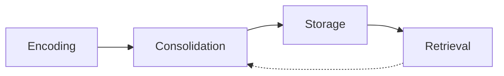

# Images, maths and diagrams

## Images

`<Space>ip` pastes an image from the clipboard into the Attachments folder. Dropping a file on the terminal in insert mode does the same. `<Space>if` makes a drawing in Inkscape; on an existing drawing it opens that one.

![[Attachments/sleep-stages.svg]]

## Maths

Inline, $E = mc^2$, or on its own:

$$
P(A \mid B) = \frac{P(B \mid A)\, P(A)}{P(B)}
$$

## Diagrams

Diagrams are drawn here when `mmdc` (mermaid-cli) is installed, and always in the browser preview.

Images and maths show in terminals with the kitty graphics protocol (Ghostty and kitty, also inside herdr). The first formula takes a minute, because the TeX files it needs are downloaded once. `<Space>xp` shows everything in the browser in any case.

## Audio

`<Space>ir` starts a recording, and again stops it and embeds the file.
