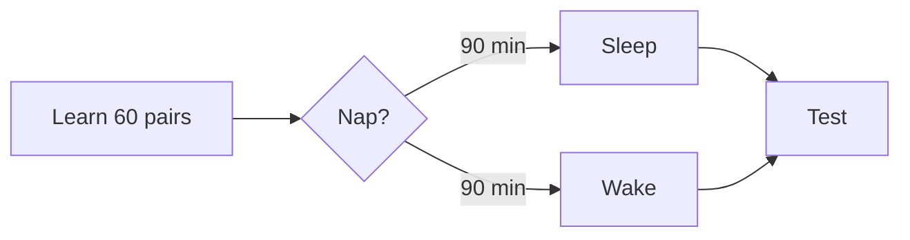

# Sleep study

Does a nap after learning help with word pairs? With [[Anna Berger]] and [[Jonas Weiss]].

## Next

- [ ] Send the ethics amendment #thesis ⏫ 📅 @@day-1@@
- [ ] Book the scanner for the pilot #thesis 📅 @@day+0@@
- [ ] Write the methods section #thesis 🔼 ⏳ @@day+1@@ 📅 @@day+4@@
- [ ] Weekly check of the recordings 🔁 every week 📅 @@day+3@@
- [ ] Read [[Why We Sleep]] again, critically #reading
- [x] Pilot the word lists ✅ @@day-1@@
- [x] Recruit first ten participants ✅ @@day-6@@

## Design

The prediction comes from [[Memory#Consolidation]]: spindle density should go with the benefit.

| Group | n  | Mean recall | SD  |
| ----- | -- | ----------- | --- |
| Sleep | 24 | 41.2        | 6.1 |
| Wake  | 23 | 36.8        | 7.0 |

## Log

- @@day-30@@ Started
- @@day-12@@ Met [[Anna Berger]] about the scanner, see [[Scanner meeting]]
- @@day-1@@ Word lists piloted
